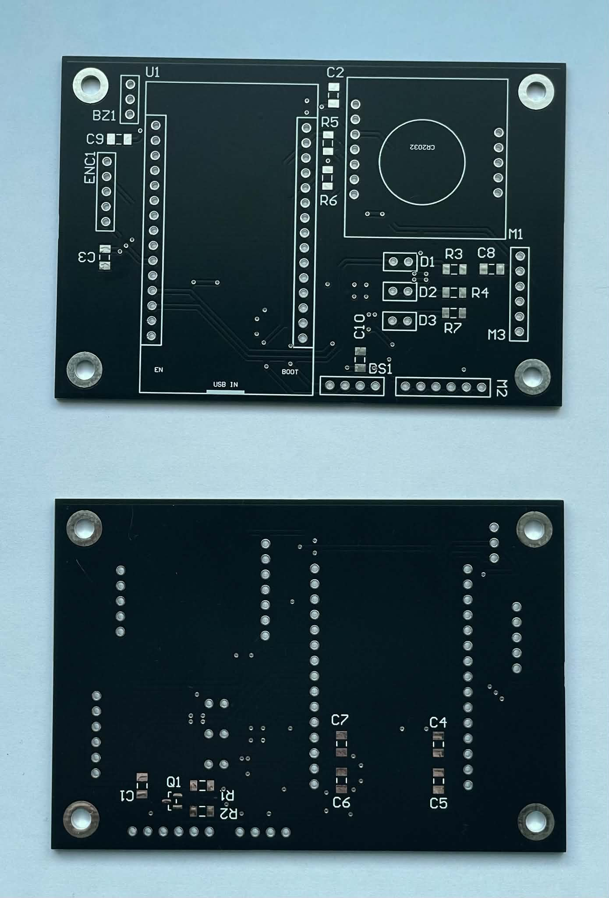
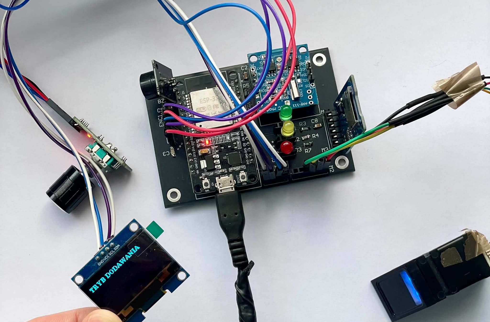

# IoT Time-Tracking Terminal with Biometric Authentication  (v2 — custom PCB)

An ESP32 terminal that records who performed which activity and for how long,
authenticated by fingerprint — and keeps working offline and reports to central server.

Engineering thesis at the Silesian University of Technology (defence: January 2027).

## The problem

A terminal which logs only to the server will lose all logs whenever Wi-Fi fails and a
local-only log is of no use for reporting. My solution does both things: we store each event in a 
powerloss-proof log at the terminal itself,
and synchronize it with the central server whenever Wi-Fi returns, without any losses or duplicates.

## How it works

**Event store.** The termianl features a microSD-based, append-only binary log with a CRC-32 in each 20-byte entry.
The event number is pre-reserved in NVS *prior* to writing the record, hence
a power outage may cause a gap in the numbers, but - still, no two events will ever have
the same number. On startup, the log is truncated to the last whole record. So there remains no data corrupted.

**Delivery.** Events are published through MQTT with QoS level 1 and the read cursor will be advanced only
when the sequence number is acknowledged by the server. It provides at-least once delivery guarantee.
The server performs deduplication using `device_id, seq` which effectively makes it _exactly_ once delivery.

**Time.** DS3231 maintains UTC, making the timestamp work after a power loss even without a network.
When there is Wi-Fi connection, SNTP resets the clock; the display is set to local time. When the terminal is not connected
to the power source a CR2032 battery keeps the DS3231 working. 

## Measured on hardware

| Operation | Time |
|---|---|
| 1:N fingerprint identification | ~0.8 s |
| Durable event write (incl. fsync) | 11–14 ms |
| Fingerprint capture | ~230 ms |

## Status

- [x] Custom 2-layer PCB (Altium Designer, manufactured by JLCPCB)
- [x] Fingerprint enrolment and 1:N identification (R307S, UART)
- [x] OLED menu with rotary encoder, LED and buzzer feedback
- [x] Crash-safe event log on microSD
- [x] Wi-Fi, RTC and SNTP time synchronisation
- [ ] MQTT synchronisation with acknowledgements
- [ ] Central server: Mosquitto, database, dashboard (Raspberry Pi)
- [ ] 3D-printed enclosure

## Hardware

| Component | Model | Interface |
|---|---|---|
| MCU | ESP32-WROOM-32 | – |
| Fingerprint sensor | GROW R307S | UART |
| Display | OLED 2.42" 128×64, SSD1309 | I2C |
| RTC | DS3231 | I2C |
| Storage | microSD | SPI |
| Input | rotary encoder with push button | PCNT + GPIO |

 

## Build

Built with ESP-IDF v5.5.1. Dependencies are handled by the component manager.

    idf.py build
    idf.py -p <PORT> flash monitor

Wi-Fi credentials are set through `idf.py menuconfig` (menu *Terminal — sieć*)
and are not stored in the repository.

## History

- **v1** (semester 5) — perfboard prototype:
  [ESP32-Biometric-Time-Tracker](https://github.com/mjazlowiecki/ESP32-Biometric-Time-Tracker)
- **v2** (semester 6) — first custom PCB, basic network features
- **v3** (engineering thesis) — firmware rewritten from scratch, offline-first
  synchronisation, PCB revision 2
