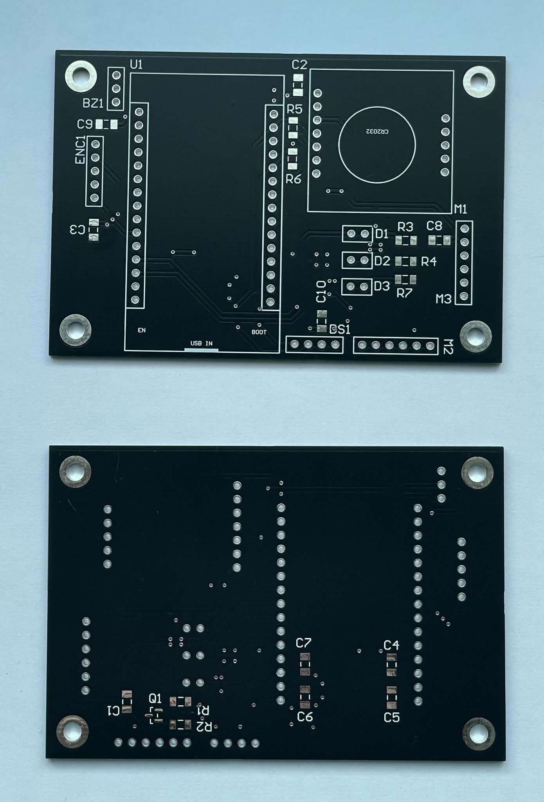
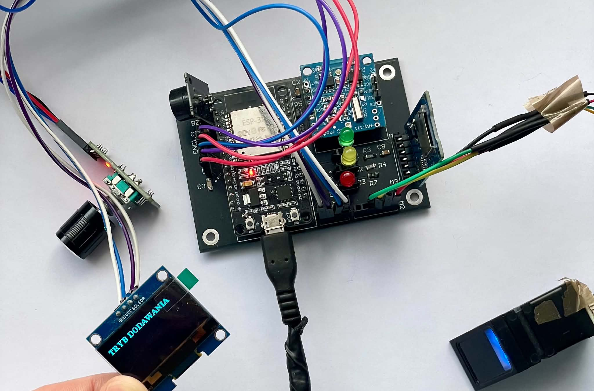
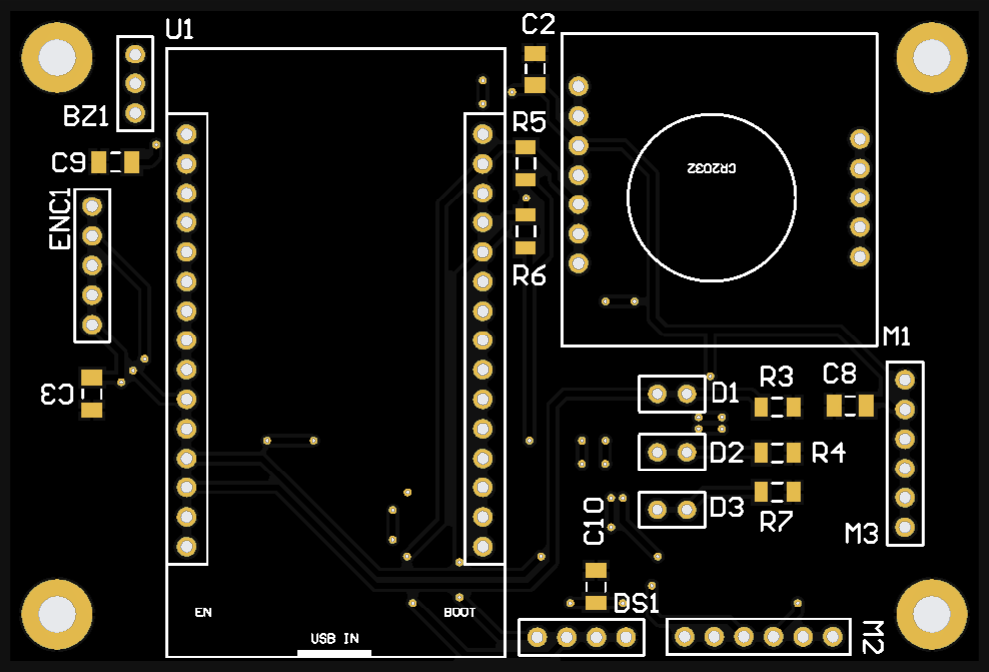
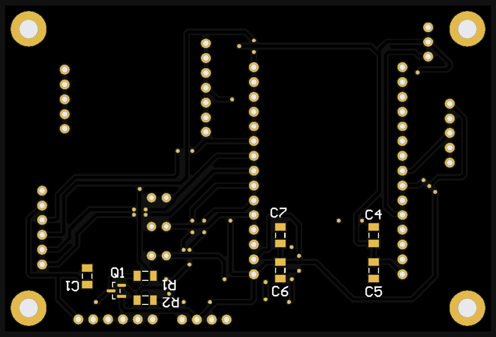
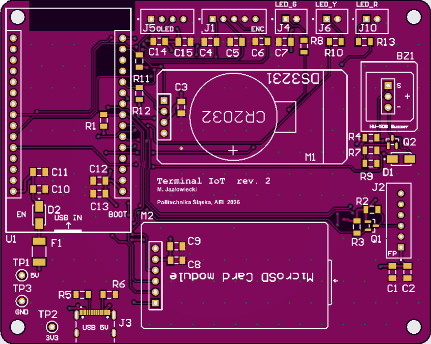
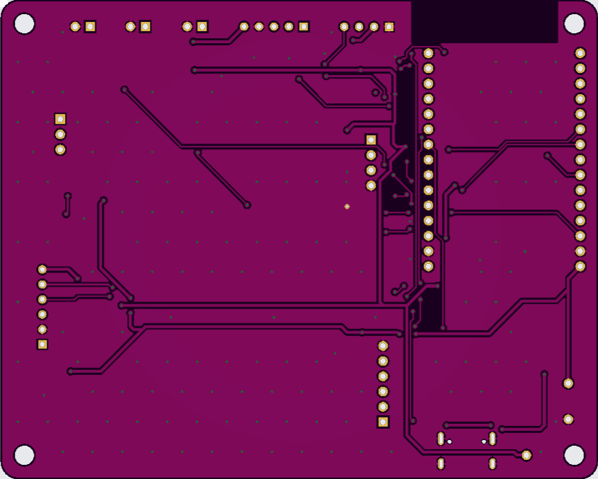

# IoT Time-Tracking Terminal with Biometric Authentication

An ESP32 terminal that records who performed which activity and for how long,
authenticated by fingerprint — and keeps working offline, synchronising with a
central server once the network returns.

Engineering thesis at the Silesian University of Technology (defence: January 2027).

  
   
  <em>The terminal running on PCB revision 1</em>

  
   
  <em>Fingerprint enrolment in progress</em>

## The problem

A terminal that logs only to a server loses every event recorded while Wi-Fi is down.
A terminal that logs only locally is useless for reporting. This project does both:
each event is first written to a crash-safe log on the device, then synchronised with
the central server once the network returns — with no lost and no duplicated events.

## How it works

**Event store.** An append-only binary log on a microSD card, with a CRC-32 in each
20-byte record. The sequence number is reserved in NVS *before* the record is written,
so a power cut can leave a gap in the numbering but never two different events sharing
one number. On boot the log is truncated to whole records, so a torn write cannot
corrupt the file.

**Delivery.** Events are published over MQTT with QoS 1, and the read cursor only
advances once the server acknowledges the sequence number. Delivery is at-least-once;
the server de-duplicates on `(device_id, seq)`, which makes it effectively exactly-once.

**Time.** A DS3231 RTC keeps UTC, so timestamps survive a power loss even without a
network, backed by a CR2032 cell while the terminal is unpowered. SNTP corrects the
clock whenever Wi-Fi is available, and the display converts to local time.

## Measured on hardware

| Operation | Time |
|---|---|
| 1:N fingerprint identification | ~0.8 s |
| Durable event write (incl. fsync) | 11–14 ms |
| Fingerprint capture | ~230 ms |

Measured on revision 1 hardware with the SPI bus at 5 MHz.

## Hardware revisions

  
  
   
  <em>Revision 1 — currently in use</em>

  
  
   
  <em>Revision 2 — in production, driven by measurements taken on revision 1</em>

Changes in revision 2:

- DS3231 RTC in place of the DS1307, so the clock survives a power loss without a network
- footprint for the 2.42" SSD1309 display
- shorter SPI routing, allowing the microSD bus to run at full speed
- external pull-up on the fingerprint sensor's RX line
- status LED moved off a strapping pin
- test points for 5 V, 3.3 V and ground; named connectors for every external module

## Hardware

| Component | Model | Interface |
|---|---|---|
| MCU | ESP32-WROOM-32 | – |
| Fingerprint sensor | GROW R307S | UART |
| Display | OLED 2.42" 128×64, SSD1309 | I2C |
| RTC | DS3231 | I2C |
| Storage | microSD | SPI |
| Input | rotary encoder with push button | PCNT + GPIO |

## Status

- [x] Fingerprint enrolment and 1:N identification (R307S, UART)
- [x] OLED menu with rotary encoder, LED and buzzer feedback
- [x] Crash-safe event log on microSD
- [x] Wi-Fi, RTC and SNTP time synchronisation
- [x] Custom 2-layer PCB, revision 1 (Altium Designer, manufactured by JLCPCB)
- [ ] PCB revision 2 — in production
- [ ] MQTT synchronisation with acknowledgements
- [ ] Central server: Mosquitto, database, dashboard (Raspberry Pi)
- [ ] 3D-printed enclosure

## Build

Built with ESP-IDF v5.5.1. Dependencies are handled by the component manager.

    idf.py build
    idf.py -p <PORT> flash monitor

Wi-Fi credentials are set through `idf.py menuconfig` (menu *Terminal — sieć*)
and are not stored in the repository.

## History

- **v1** (semester 5) — perfboard prototype:
  [ESP32-Biometric-Time-Tracker](https://github.com/mjazlowiecki/ESP32-Biometric-Time-Tracker)
- **v2** (semester 6) — first custom PCB, basic network features
- **v3** (engineering thesis) — firmware rewritten from scratch, offline-first
  synchronisation, PCB revision 2